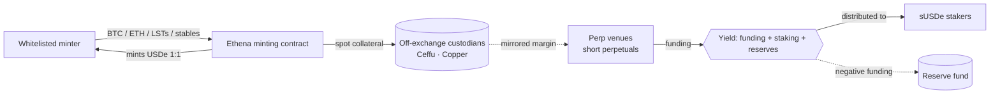

<div align="center">

# Ethena (USDe / ENA): Due Diligence

**An independent risk assessment of crypto's largest synthetic dollar, with reproducible on-chain analysis**

[**Read the report (PDF)**](report/Ethena_Due_Diligence_Report.pdf) · [Report source](report/ethena_due_diligence.md) · [Dune SQL](dune/) · [Data](data/) · [Charts](charts/)


</div>

---

## The verdict in 30 seconds

> **USDe/sUSDe: Medium risk. ENA: High risk.**
>
> The mechanism has been stress-tested and held. About **$8.3B** was redeemed after the 10 October 2025 liquidation cascade with **no on-chain depeg**, and backing still matches supply 1:1. But USDe is **a carry trade wrapped as a token**: its supply has gone through three boom-bust cycles that follow perpetual funding rates, and it is now **$4.76B, 68% below its peak**. ENA's value capture (the fee switch approved in 2026) only starts once USDe supply reaches **$7.5B**.

| Rank | Risk | Likelihood | Impact |
|:--:|---|:--:|:--:|
| 1 | **Funding-rate and demand.** The yield and the supply both depend on the funding regime | Likely | Moderate |
| 2 | **Counterparty and custody.** ~90–95% of backing sits with two custodians (Ceffu, Copper) | Unlikely | Severe |
| 3 | **Regulatory.** No EU/US licence; BaFin forced a German wind-down in 2025 | Likely | Moderate |

<p align="center"></p>

## What's inside

| | |
|---|---|
| 📄 **[The report](report/Ethena_Due_Diligence_Report.pdf)** | 15 pages: a one-page executive summary, then the project overview, tokenomics, on-chain analysis, a 7-risk register, competitive landscape and conclusion with explicit triggers that would change the view |
| 🧮 **[Dune queries](dune/)** | 5 DuneSQL queries rebuilding USDe supply, sUSDe staking ratio, holder concentration (contracts vs EOAs), ENA exchange flows around unlocks, and gross mint/redeem churn from raw `Transfer` events |
| 📊 **[Charts](charts/)** | 9 figures generated from the CSVs, including two analytical models (yield leverage, reserve-fund runway) |
| 🗂️ **[Data](data/)** | Curated CSVs. **Every row has a source and a confidence tag** ([provenance](data/SOURCES.md)) |
| 🐍 **[Scripts](scripts/)** | Vesting model with built-in reconciliation checks, chart builder, PDF builder, and an API refresher (DefiLlama, CoinGecko, Binance) |

## Highlights

<table>
<tr>
<td width="50%"></td>
<td width="50%"></td>
</tr>
<tr>
<td><b>Vesting model reconciled to the token.</b> Rebuilt from Ethena's published terms. The script <i>asserts</i> that it reproduces the reported 171.875M monthly unlock and the 1,406.25M accelerated investor release, so the model is checked against reality, not just plotted.</td>
<td><b>sUSDe yield is leveraged by the staking ratio.</b> A 5.0% APY with only 26% of USDe staked implies just ~1.3% net yield on the whole backing. The headline APY overstates the underlying economics.</td>
</tr>
<tr>
<td width="50%"></td>
<td width="50%"></td>
</tr>
<tr>
<td><b>How long can the reserve fund absorb negative funding?</b> This turns the abstract "funding risk" into a number: ~16 weeks at −10% on $2B of hedges, ~8 weeks at −20%. That number becomes the conclusion's trigger.</td>
<td><b>Risks scored and correlated.</b> The report argues that funding, peg and liquidity risk are <i>one risk in three forms</i>, and that October 2025 was the joint stress scenario.</td>
</tr>
</table>

## How it works



## Methodology principles

1. **Primary sources first.** Mechanics come from Ethena's documentation and governance updates, not from blogs. Secondary sources are used only where flagged.
2. **Separate the known from the unverified.** The conclusion includes a two-column table of what was verified and what could not be. Low-confidence data points appear as **hollow markers** on the charts.
3. **Reproducible.** Every chart is generated from CSVs by code. Every on-chain claim has a query.
4. **Falsifiable view.** The conclusion lists the specific, measurable conditions that would make the view worse (e.g. *"7-day funding negative for more than 8 consecutive weeks while hedged notional is above $2B"*) or better.

## Reproduce it

```bash
git clone <this repo> && cd Ethena
pip install -r requirements.txt
python -m playwright install chromium   # only needed for the PDF

make all      # vesting model → charts → PDF
make fetch    # optional: refresh supply, price and funding data into data/raw/
```

On-chain: paste any file from [`dune/`](dune/) into a new query at [dune.com](https://dune.com). Contract addresses and design notes are in [`dune/README.md`](dune/README.md).

## Repository layout

```
├── report/
│   ├── Ethena_Due_Diligence_Report.pdf   ← the deliverable
│   ├── ethena_due_diligence.md           ← source text
│   └── ethena_due_diligence.html         ← web version
├── dune/          5 DuneSQL queries + contract addresses
├── data/          curated, source-tagged CSVs
├── charts/        generated figures (PNG, 200 dpi)
├── scripts/
│   ├── build_unlock_schedule.py   vesting model with reconciliation asserts
│   ├── make_charts.py             all figures
│   ├── build_pdf.py               Markdown → HTML → PDF (headless Chromium)
│   └── fetch_data.py              DefiLlama / CoinGecko / Binance refresher
└── Makefile
```

## Limitations

- **Dune outputs pending.** The queries are written and checked against the Spellbook schema but have not been run yet. The 2024 to mid-2025 USDe supply points are approximate (hollow markers) and should be replaced with the Q01 output.
- **The reserve fund size (~$61M)** comes from a single secondary source. The runway chart is a sensitivity analysis, not a forecast.
- **Fee-switch revenue share.** Sources conflict (tiered 5–20% vs "up to 95%"). The report flags this rather than picking one.
- Data is as of **12–16 October 2026**. Crypto moves fast, so check current figures before relying on any number.

---

<sub>Independent research for educational purposes. Not investment advice. Charts use a colour-vision-deficiency-safe palette.</sub>
