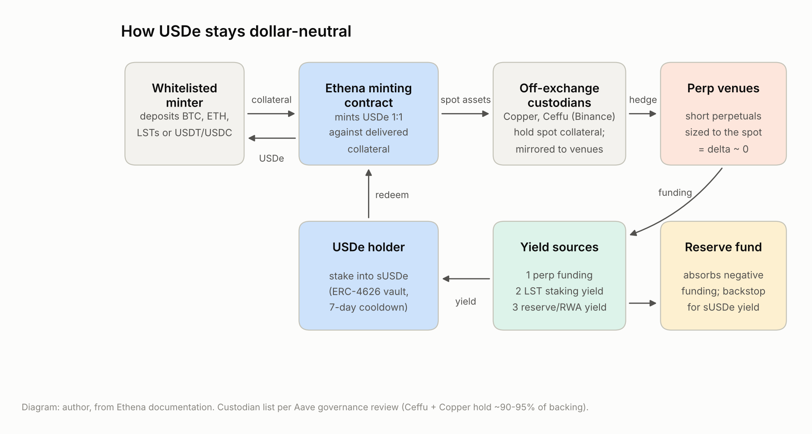
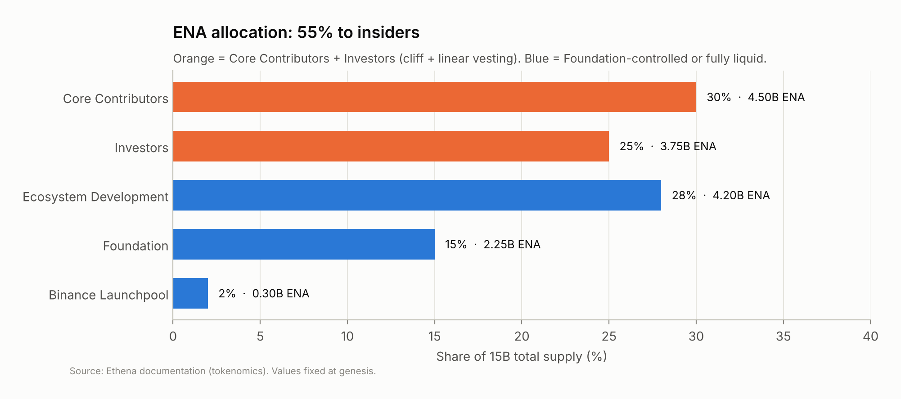
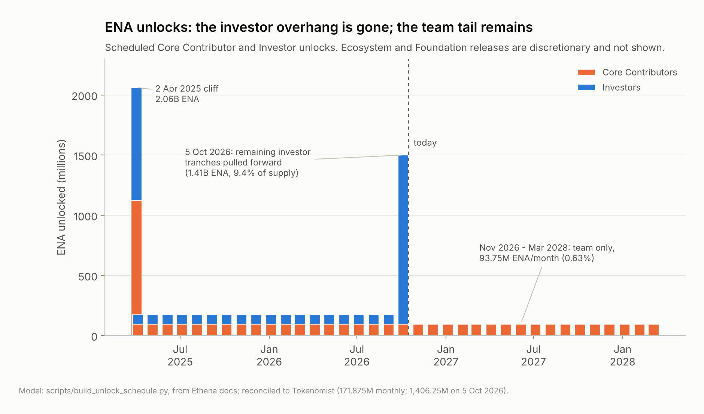
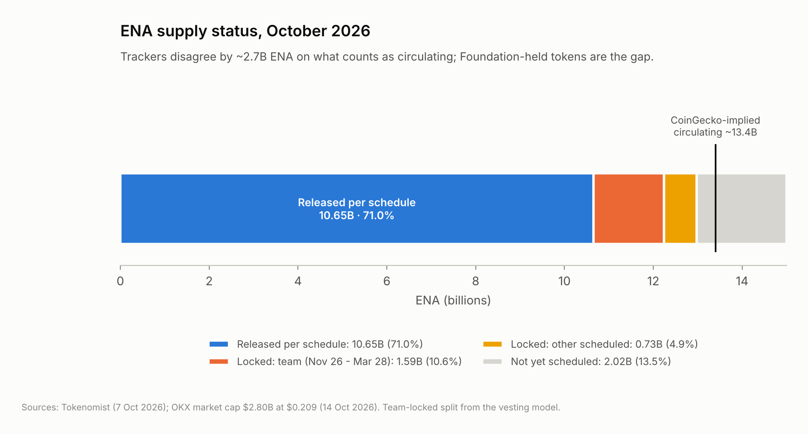
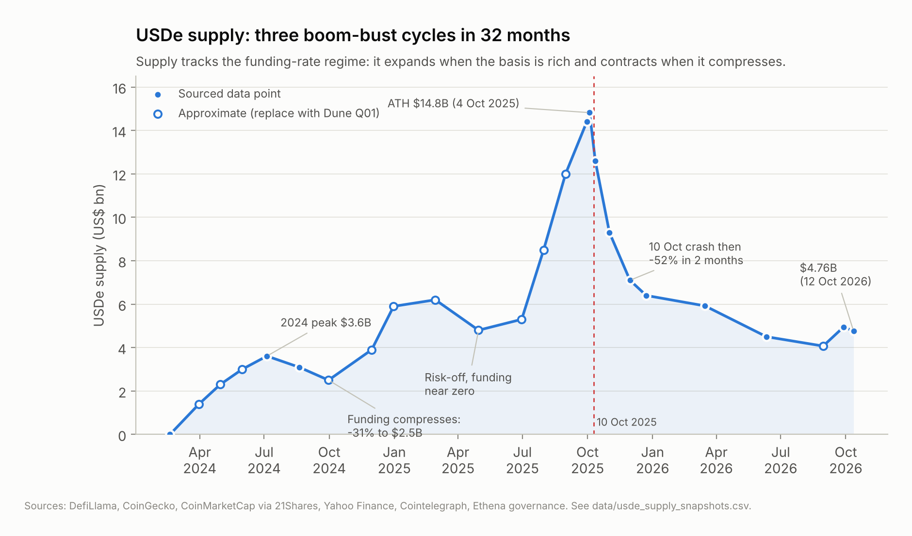
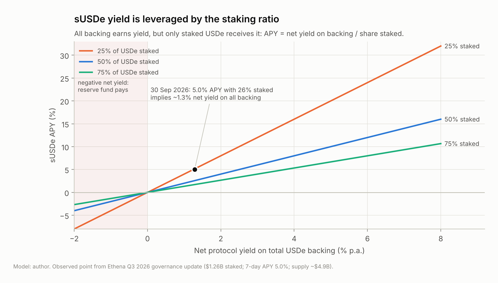
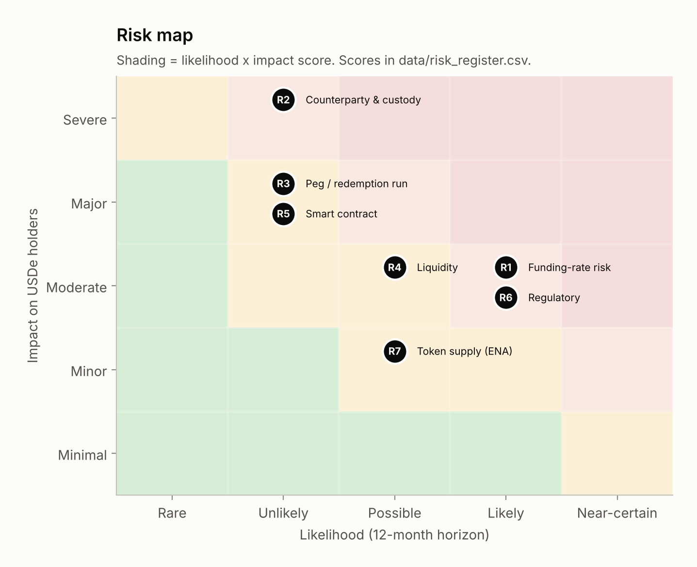
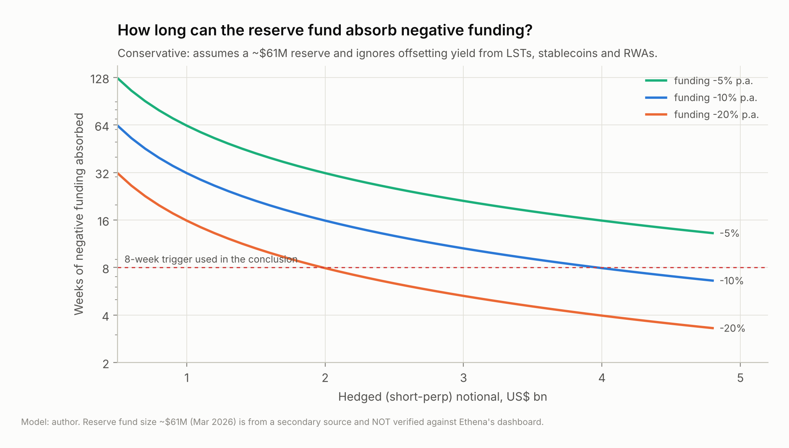
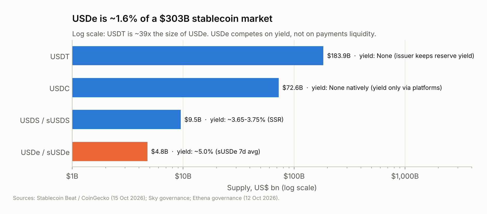

Data as of 12–16 October 2026 · All figures in US$ · Sources listed in Appendix A

# Executive summary

**What it is.** Ethena issues **USDe**, a synthetic dollar backed by crypto and stablecoin collateral. The volatile part of the collateral is hedged with short perpetual futures, so the position stays close to dollar-neutral. Holders who stake USDe as **sUSDe** receive the protocol's yield, which comes from perpetual funding, staking rewards and reserve income. **ENA** is the governance token.

**Overall view: Medium risk for USDe/sUSDe holders. High risk for ENA holders.**

The mechanism has been tested hard and held. In the two months after the 10 October 2025 liquidation cascade, about **$8.3B** of USDe was redeemed (−57%). The on-chain peg held throughout, and backing still matched supply 1:1 in October 2026. What keeps the risk at Medium rather than Low:

1. **The product depends on the funding regime.** Supply has gone through three boom-bust cycles in 32 months. It is now **$4.76B**, 68% below its October 2025 peak. Each contraction followed a fall in perpetual funding rates.
2. **Collateral custody is concentrated.** About 90–95% of backing is held by two off-exchange custodians, **Ceffu (Binance's institutional custody arm) and Copper**. These are low-probability, high-impact exposures that the holder cannot diversify away.
3. **The yield premium is thin.** sUSDe paid **~5.0%** at the end of Q3 2026. Sky's savings rate, a lower-risk on-chain alternative, paid about 3.7%. A premium of about 1.3 percentage points is small payment for funding, custody and venue risk.

ENA is rated High because the token's value capture is conditional. The approved fee switch only starts buybacks once USDe supply reaches **$7.5B**, about 58% above today's level. On the positive side, the Foundation's 2026 investor buyout and the pull-forward of all remaining investor unlocks removed most of the scheduled supply overhang.

**The three most important risks, ranked**

| # | Risk | Why it ranks here |
|---|------|-------------------|
| 1 | **Funding-rate and demand risk** | This risk has already materialised three times. Falling funding cuts sUSDe yield, then demand, then supply. A long stretch of negative funding would also draw down the reserve fund. |
| 2 | **Counterparty and custody concentration** | Unlikely, but the impact would be severe. A custodian failure or a perp venue failure (an FTX-type event) would affect backing directly. One of the two main custodians is affiliated with Binance. |
| 3 | **Regulatory risk** | USDe has no EU or US licence. In 2025 BaFin forced Ethena to wind down its German entity, and US payment-stablecoin rules are written for reserve-backed tokens, not synthetic dollars. Distribution to regulated users is therefore limited. |

*How this report treats evidence.* I tag each important number by how well it is supported. Section 6 separates what I verified from what I could not, and Appendix A lists every source.

# 1. Project overview

## 1.1 The problem it solves

Stablecoins are crypto's main unit of account, but the two largest, **USDT ($184B)** and **USDC ($73B)**, pay holders nothing. The issuers keep the reserve yield. There is lasting demand for a **crypto-native dollar that pays a yield** without relying on a bank. Ethena's answer is to source that yield from crypto's own derivatives market. Perpetual futures longs have historically paid shorts a positive funding rate, and Ethena collects it by being structurally short.

## 1.2 How it works

1. **Mint.** A whitelisted market maker delivers collateral (BTC, ETH, liquid-staking tokens, or USDT/USDC) and receives newly minted USDe 1:1. Retail users get USDe on secondary markets. Only whitelisted entities can mint or redeem directly.
2. **Custody.** The spot collateral is not deposited on exchanges. It sits with off-exchange settlement (OES) custodians, mainly **Copper (ClearLoop)** and **Ceffu (MirrorX)**. Their balances are mirrored to the derivatives venues as margin, so a venue failure should not directly take the spot assets.
3. **Hedge.** Ethena opens short perpetual positions sized to the volatile collateral, which leaves the combined position delta-neutral. A $1 fall in ETH loses $1 on the spot and gains $1 on the short.
4. **Yield.** Three sources: (a) **funding** paid by perp longs to shorts, (b) **staking yield** on liquid-staking-token collateral, and (c) **income on stablecoin and real-world-asset reserves**. When funding is unattractive, Ethena moves backing into stablecoins and tokenised T-bills. By April 2026 the hedged perp book had reportedly fallen to about 11% of backing. Ethena's Q3 2026 update says the basis trade had returned as a "material share" of backing.
5. **Distribute.** Only **staked** USDe (sUSDe, an ERC-4626 vault with a 7-day unstaking cooldown) receives the yield. The **reserve fund** absorbs periods of negative funding.

## 1.3 Team, investors and backers

| | Publicly known | Not public / unverified |
|---|---|---|
| **Team** | Founder and CEO **Guy Young** (previously at Cerberus Capital Management, about six years in TradFi). Ethena Labs is the development company. The Ethena Foundation (BVI) runs governance and the token. | Most contributor identities and team size. How compensation is split between Labs and the Foundation. |
| **Seed (Jul 2023)** | $6M led by **Dragonfly**. Participants reportedly included **Deribit, Bybit, OKX, Gemini, Huobi** and **Arthur Hayes** (Maelstrom). | Exact allocation per investor. |
| **Strategic (Feb 2024)** | $14M at a $300M valuation. **Dragonfly, Brevan Howard, Maelstrom** and others. | |
| **2025** | A $100M token sale (Feb 2025; Franklin Templeton and F-Prime reported). **$20M from M2** (Sep 2025). | Terms of the 2025 token sale. Reports conflict on the investor list. |

**A point a DD reader should notice:** several seed investors are also **the venues where Ethena holds its hedges** (Bybit, OKX, Deribit). That aligns incentives, since the venues want Ethena's open interest. It also creates a relationship that is commercial as well as financial.

## 1.4 Position in the market

USDe is the **largest synthetic dollar** and was briefly the third-largest dollar stablecoin in October 2025 at **$14.8B**. At **$4.76B** today it is roughly **1.6% of a $303B stablecoin market**. That is about half the size of Sky's USDS and about one-fortieth of USDT. Ethena is now spreading its infrastructure across more products:

- **USDtb**, a reserve-backed stablecoin issued with Anchorage Digital Bank for the US-regulated market
- **white-label stablecoins** (ether.fi USD was announced in October 2026; Maple, Jupiter, MegaETH and Sui were named as partners)
- **iUSDe** and the Converge chain for institutions

# 2. Tokenomics (ENA)

## 2.1 Supply and allocation

**Total supply is fixed at 15 billion ENA.** The token launched on **2 April 2024** with 1.425B (9.5%) circulating.

| Group | Share | ENA | Terms |
|---|---|---|---|
| Core Contributors | 30% | 4.50B | 1-year cliff for 25%, then 36 monthly tranches |
| Investors | 25% | 3.75B | As above. **Remaining tranches accelerated into 5 Oct 2026** |
| Ecosystem Development | 28% | 4.20B | Airdrops and incentives. Released at the Foundation's discretion |
| Foundation | 15% | 2.25B | Released at the Foundation's discretion |
| Binance Launchpool | 2% | 0.30B | Fully liquid at TGE |

## 2.2 Vesting and the 2026 restructuring

I rebuilt the insider vesting schedule from Ethena's published terms ([`scripts/build_unlock_schedule.py`](../scripts/build_unlock_schedule.py)). The model reproduces two independently reported figures exactly: the **171.875M ENA** combined monthly unlock (e.g. 5 March 2026) and the **1,406.25M ENA** accelerated investor release on 5 October 2026.

Two governance actions in 2026 changed the supply picture:

1. **Investor buyout (announced 27 Aug 2026).** Over two weeks, the Foundation bought, OTC, all locked tokens held by major seed investors (those with more than 0.25% of supply) who had sold ENA in the previous nine months. One wallet that said it would hold was excluded.
2. **Acceleration.** All remaining investor tranches (Nov 2026 to Mar 2028) were pulled forward into the **5 October 2026** release.

The logic is to **swap a predictable monthly overhang for a single event and then a cleaner float.** ENA rose about 84% in the month after the announcement. That is a market judgement that a known, priced-in cliff is better than 18 months of drip selling.

## 2.3 Supply pressure from here

- **Scheduled:** about **1.59B ENA (10.6% of supply)** of Core Contributor tokens unlock at **93.75M per month (0.63%) from Nov 2026 to Mar 2028**. Tokenomist reports another ~0.73B scheduled from other categories.
- **Discretionary:** about 2.0B ENA is not on any published schedule. These are mostly Ecosystem and Foundation tokens, and they can enter circulation whenever the Foundation decides.
- **Trackers disagree.** Tokenomist counts **10.65B (71%)** as released. CoinGecko's market cap implies **~13.4B** circulating. The ~2.7B gap is Foundation-held ENA that some trackers count as circulating. *For valuation, use the higher figure. It is the conservative choice.*

## 2.4 Utility and value capture

| Function | Status (Oct 2026) |
|---|---|
| Governance | ENA (and staked **sENA**) votes on the Risk Committee, collateral and parameters. Foundation influence is substantial. |
| Restaking / security | sENA can be restaked to secure Ethena-network infrastructure (Converge). Real economic weight is so far limited. |
| **Fee switch** | **Approved in Q3 2026.** Directs Foundation net revenue to **ENA buybacks**, starting once **USDe supply reaches $7.5B**, with higher tiers at $10B, $15B and $20B. *Reported revenue shares conflict (tiered 5% to 20% vs "up to 95%"). Verify against the Snapshot text.* |
| Incentives | ENA-funded USDe incentives **ended on 30 September 2026**. This removes a cost to ENA holders, and also removes a source of USDe demand. |

**Key question: does ENA capture value from protocol growth, or is it mainly a governance token?**
Today it is **mainly a governance token with an option on value capture.** The fee switch exists, but it is out of the money. USDe would need to grow about 58% to reach the first threshold, at a time when supply is shrinking and incentives have ended. Value capture therefore depends on the same variable that drives everything else at Ethena, the funding regime. **ENA is a leveraged bet on USDe growth, not a claim on today's cash flows.**

# 3. On-chain analysis

> The SQL behind this section is in [`dune/`](../dune/). Five DuneSQL queries reconstruct supply, staking ratio, holder concentration, exchange flows and gross mint/redeem churn directly from `erc20_ethereum.evt_Transfer`.

## 3.1 USDe supply: growth, contractions and their cause

| Cycle | Expansion | Contraction | Trigger |
|---|---|---|---|
| 2024 | $0 → **$3.6B** (Jul 2024) | → ~$2.5B (Sep 2024), about −31% | Funding compressed in the summer 2024 drawdown |
| 2024–25 | → ~$6.2B (Feb 2025) | → ~$4.8B (Apr 2025), about −23% | Risk-off market, funding near zero |
| 2025–26 | → **$14.8B** (4 Oct 2025) | → **$4.76B** (Oct 2026), **−68%** | 10 Oct 2025 cascade, a deleveraging of open interest, then incentives winding down |

**Interpretation.** USDe demand is **pro-cyclical and yield-elastic.** Supply grows when leveraged longs pay a high funding rate and shrinks when they stop. That is the design working, not failing: redemptions are how the protocol shrinks its hedge book. The point for a DD reader is that **USDe is not a store-of-value dollar that sticks around. It is a carry trade wrapped as a token,** and holders leave when the carry fades.

**The October 2025 stress test.** On 10 October 2025, during the largest liquidation event in crypto history, USDe traded at about **$0.65 on Binance's spot order book** for roughly 90 minutes. **On-chain, on Curve and on other venues, it stayed close to $1.** The cause was venue-specific: Binance's internal oracle priced collateral from its own thin order book. Binance paid about $283M in compensation and changed its index to use redemption prices. Over the next ~10 weeks about **$8.3B** was redeemed through the mint/redeem path without an on-chain depeg. **This is the strongest piece of evidence in the report that the redemption mechanism works under stress.**

## 3.2 sUSDe staking: how much users rely on the yield

| | 1 Jul 2026 | 30 Sep 2026 |
|---|---|---|
| USDe staked in sUSDe | **$1.67B** | **$1.26B** |
| Share of USDe supply staked | ~37% | **~26%** |
| sUSDe 7-day APY | 3.8% | **5.0%** |

Only staked USDe receives yield, so the **staking ratio leverages the APY.** A 5.0% APY with 26% staked implies the protocol was earning a net **~1.3%** on its whole backing. That is consistent with a large share of backing sitting in low- or zero-yield stablecoins, and with part of the revenue being kept back. Two implications follow:

- **The headline yield overstates the economics.** If more holders stake, APY falls even if nothing else changes.
- **The falling staking ratio is a leading indicator.** Unstaked USDe is mostly held for DeFi use: Pendle, lending collateral, and exchange margin on Binance and Bybit. That demand is stickier than yield demand but less directly tied to Ethena's revenue.

## 3.3 Holder concentration

Query **Q03** computes top-10 and top-100 shares for ENA and USDe in two views: all addresses, and externally owned accounts only. **One finding follows from the staking data without running the query: the largest USDe "holder" is the sUSDe vault, at about 26% of supply.** Pendle markets, Aave, and the LayerZero bridge adapter will rank next. Raw top-10 numbers therefore mostly measure **DeFi integration rather than whale risk**, and the EOA-only view is the one that matters for run risk. For ENA, the largest wallets are Foundation, vesting and exchange addresses. *Q03 output is pending (see Section 6).*

## 3.4 Exchange flows around unlocks

Query **Q04** measures net ENA inflows to labelled CEX wallets in a ±7-day window around every unlock date from April 2025 to October 2026. The hypothesis to test is that **net inflows rise in the days after each unlock**. The evidence available so far is suggestive: ENA fell about 11.6% in the week of the 5 October 2026 release, despite positive news from the ether.fi partnership. Because `cex.addresses` misses unlabelled deposit wallets, the query gives a **lower bound** on inflows.

# 4. Risk assessment

Likelihood (L) and impact (I) are each scored from 1 to 5, over a 12-month horizon, from the point of view of a USDe/sUSDe holder.

| Risk | Description | L | I | Mitigation (and residual gap) |
|---|---|:-:|:-:|---|
| **R1 Funding-rate** | Funding has ranged from about −6% to +75% annualised (2023–25). If it stays negative, shorts pay longs. Yield goes to zero and the hedge **costs** money. | 4 | 3 | Reserve fund. Moving backing into stablecoins and T-bills when funding is below the risk-free rate. *Gap:* the reserve was reportedly about **$61M (~1.1% of supply, Mar 2026)**. That figure is unverified. At −10% funding on $2B of hedges it covers **~16 weeks**; at −20% it covers **~8 weeks** (Fig. 7). |
| **R2 Counterparty and custody** | Spot collateral sits with OES custodians and hedges sit on exchanges. **About 90–95% of backing is held across Ceffu (Binance's institutional custody arm) and Copper.** Venue exposure includes Binance, Bybit, OKX and Deribit. | 2 | 5 | OES keeps assets bankruptcy-remote from venues. Positions are spread across venues. Monthly custodian attestations. *Gap:* custody is concentrated in two names. A venue failure still forces an unplanned unwind of the hedge, with basis loss. |
| **R3 Peg and redemption run** | A sharp crash combined with mass redemptions could force hedges to close at bad prices, or a single venue could misprice USDe (as Binance did on 10 Oct 2025). | 2 | 4 | Redemptions are delta-neutral by design. **About $8.3B was redeemed after Oct 2025 with no on-chain depeg.** Binance added a redemption-price floor to its index. *Gap:* the 7-day sUSDe cooldown can trap stakers during a run. |
| **R4 Liquidity** | USDe secondary liquidity is concentrated in Curve/Uniswap pools and a few CEXs. ENA trades about $300M+ per day (Bybit, 14 Oct 2026). | 3 | 3 | Whitelisted market makers arbitrage between primary redemption and secondary markets. *Gap:* retail cannot redeem directly. In a crisis, retail exits through AMM pools that may be thin. |
| **R5 Smart contract** | Exploit of the minting, staking or bridge contracts. | 2 | 4 | Audits by **Zellic, Quantstamp, Spearbit/Cantina, Pashov, Code4rena** (0 high or critical findings). Economic audit by **Chaos Labs**. No exploit of core contracts found in public sources. *Gap:* the audits cover v1. Newer surfaces (bridges, Converge, white-label) need their own review. |
| **R6 Regulatory** | **BaFin rejected Ethena GmbH's MiCA application (Mar 2025)** and the German entity was wound down. BaFin also warned that sUSDe may be an unlicensed security. USDe has **no EU or US licence**. US stablecoin rules (GENIUS Act, Jul 2025) cover reserve-backed payment tokens and do not cover a derivatives-backed synthetic dollar. | 4 | 3 | Issuance moved to BVI entities. USDtb (through Anchorage, a federally chartered bank) serves the regulated market. *Gap:* restrictions on distribution limit USDe's addressable market. Some exchanges may delist it in some regions. |
| **R7 Token supply (ENA)** | Selling pressure from team unlocks (0.63% per month) and from discretionary Foundation releases. | 3 | 2 | Investor overhang removed through the buyout and acceleration. Fee switch provides buybacks above $7.5B of USDe. *Gap:* about 2B ENA is unscheduled and at the Foundation's discretion. |

**What the matrix does not show is correlation.** R1, R3 and R4 are **one risk in three forms**. A crash flips funding negative (R1), which triggers redemptions (R3), which hit AMM liquidity (R4), all in the same week. The relevant stress scenario is all three together, not each one separately. October 2025 was that scenario, and the protocol came through it at about $14.8B of size.

# 5. Competitive landscape

| | **USDT** | **USDC** | **USDS / sUSDS** (Sky) | **USDe / sUSDe** (Ethena) |
|---|---|---|---|---|
| **Mechanism** | Fiat reserves (T-bills; some BTC and gold) | Cash and T-bills; regulated issuer | Over-collateralised crypto + RWA; governance-set savings rate | Spot collateral + short perps + stablecoin/RWA reserves |
| **Yield source** | None to holders | None natively | Sky Savings Rate, **~3.65–3.75%** | Funding + LST staking + reserve income, **~5.0%** |
| **Size** | **$184B** | **$73B** | **~$9–11B** | **$4.76B** |
| **Main risk** | Issuer transparency | Banking and custody concentration; freeze risk | Governance; RWA and PSM concentration | Funding regime; exchange and custody counterparties |

**USDe's position:** it does not compete with USDT/USDC on payments, and it should not try to. It competes with **sUSDS and tokenised T-bill funds for on-chain yield.** Its edge is that its yield **rises in bull markets**, when funding is rich, which is exactly when T-bill-based yields look dull. Its weakness is the reverse: in bear markets its yield falls toward or below the risk-free rate, and capital moves to sUSDS and T-bills. **Ethena's response, which is the right one, is to become the infrastructure layer** (USDtb, white-label stablecoins) rather than rely on a single carry product.

# 6. Conclusion

**USDe/sUSDe: Medium risk. ENA: High risk.** USDe is a well-engineered, transparently reported product that has come through a real stress event. Its risks are structural (funding regime, custodial concentration), not hidden. ENA's investment case depends on USDe returning to above $7.5B.

## What would change my view

| My view would **worsen** if… | My view would **improve** if… |
|---|---|
| BTC/ETH 7-day average funding stays **negative for more than 8 consecutive weeks** while hedged notional is above $2B. At that point the reserve fund is under 8 weeks from exhaustion (Fig. 7). | The reserve fund is disclosed at **≥2% of supply** with on-chain verifiability. |
| Any single custodian holds **more than 60% of backing**, or Ceffu/Copper suffer an operational incident. | A **third independent custodian** takes a material share. |
| USDe trades **below $0.98 on Curve for more than 24 hours** (on-chain, not on one venue). | USDe supply recovers past **$7.5B**, which turns on the fee switch and gives ENA real value capture. |
| sUSDe APY falls **below the Sky Savings Rate for a full quarter** while staked supply drops below $1B, which would be a demand spiral. | A regulated wrapper or licence widens distribution. |

## What I know vs. what I could not verify

| Verified against primary or multiple consistent sources | Not verified, or sources conflict |
|---|---|
| USDe supply $4.76B, 1:1 backed (12 Oct 2026, Ethena governance; Aave review) | **Reserve fund size** (~$61M is from one secondary source) |
| sUSDe staked $1.67B → $1.26B and APY 3.8% → 5.0% in Q3 2026 (Ethena governance) | **Fee-switch revenue share** (tiered 5–20% vs "up to 95%") |
| ENA allocation and vesting terms; 171.875M monthly and 1,406.25M accelerated figures (reconciled in my model) | **Current backing mix** (perp share ~11% in Apr 2026 vs "material" in Q3) |
| Investor buyout (27 Aug 2026) and incentives ending (30 Sep 2026) | **ENA circulating supply** (10.65B vs ~13.4B depending on tracker) |
| Oct 2025 Binance-only depeg, $283M Binance compensation | **2024–mid-2025 monthly USDe supply points** (approximate; Dune Q01 replaces them) |
| BaFin MiCA rejection and wind-down of Ethena GmbH | **Q03/Q04 outputs** (queries written, results pending) |
| Audit firms and findings for v1 contracts | Identities of most team members; 2025 token-sale terms |

*A DD team should weight this report by the left column. Everything in the right column is flagged in the text where it is used.*

# Appendix A: Sources

**Primary / official**
- Ethena documentation: mechanism, tokenomics, audits, key addresses (docs.ethena.fi)
- Ethena Foundation governance forum: July–September 2026 update; January–June 2026 updates (gov.ethenafoundation.com)
- Ethena Foundation announcement of the investor buyout and fee switch (X / blog, 27 Aug 2026)
- Audit reports: Zellic, Quantstamp, Spearbit, Pashov, Code4rena (2023-10-ethena), Chaos Labs
- Aave governance: USDe/sUSDe risk reviews (custodian split, backing ratio)

**Data**
- DefiLlama (stablecoin supply), CoinGecko / CoinMarketCap (prices, market cap), Tokenomist (unlocks, 7 Oct 2026), Stablecoin Beat (stablecoin market, 15 Oct 2026), OKX/Bybit/Coinbase price pages (14 Oct 2026)

**Secondary (used only where flagged)**
- 21Shares research (Oct 2025 depeg); The Block (Binance compensation; BaFin); Cointelegraph, Yahoo Finance (supply after the crash); Decrypt (German wind-down); Bird & Bird (Frankfurt court on MiCAR); stablecoininsider (Q1 2026; Sep 2026 review); KuCoin News, CoinCentral, Blockonomi (buyout coverage); cryptoticker (ether.fi white-label)

# Appendix B: Methodology

- **Charts** are generated by [`scripts/make_charts.py`](../scripts/make_charts.py) from the CSVs in [`data/`](../data/). Every CSV row carries a source and a confidence tag.
- **Vesting model**: [`scripts/build_unlock_schedule.py`](../scripts/build_unlock_schedule.py) contains assertions that it reproduces the reported 171.875M and 1,406.25M figures.
- **Yield model** (Fig. 6): sUSDe APY = net protocol yield on all backing ÷ share of USDe staked.
- **Reserve runway** (Fig. 7): weeks = reserve ÷ (hedged notional × |funding| ÷ 52). This is conservative because it ignores offsetting LST and reserve income.
- **Risk scores**: likelihood × impact on a 5×5 grid, 12-month horizon, from the USDe holder's point of view ([`data/risk_register.csv`](../data/risk_register.csv)).

*This report is independent research for educational purposes and is not investment advice.*
